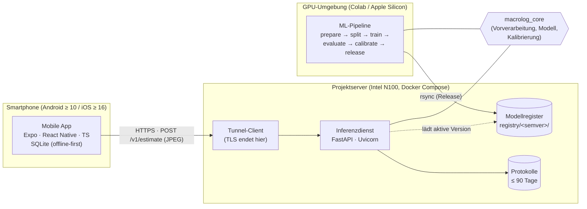

# Architektur – MacroLog+

Kurzfassung des High Level Design (HLD v1.0, 04.11.2026) und der SRS (v1.0, 23.10.2026).
Die vollständigen Dokumente liegen lokal im Team (nicht im öffentlichen Repository).

## Komponenten

| Komponente | Ordner | Technik | Verantwortung |
|---|---|---|---|
| Mobile App | `app/` | Expo SDK 58, React Native, TypeScript, Expo Router, expo-sqlite | UI, Kamera/Aufnahmehilfe, lokale Datenhaltung, Darstellung von Schätzung + Unsicherheit |
| Inferenzkern | `core/` (`macrolog_core`) | Python 3.12, PyTorch, torchvision | **einzige** Implementierung von Vorverarbeitung, Modell, Kalibrierung → kein Training-Serving-Skew (FR-15, TS-08) |
| ML-Pipeline | `ml/` (`macrolog_ml`) | PyTorch, pandas, PyArrow, SciPy | Daten, Splits, Training A/B/C, Evaluation, Kalibrierung, Release |
| Inferenzdienst | `service/` (`macrolog_service`) | FastAPI, Uvicorn, Pydantic, Docker | API-Key, Eingabeprüfung, Orchestrierung, Logging ohne Bild |
| Betrieb | `deploy/` | Docker Compose, Tunnel (z. B. Tailscale Funnel) | Projektserver, Modellregister, Health-Check |
| Kontodienst (optional, K-01) | – (noch nicht angelegt) | FastAPI, PostgreSQL, Argon2id | Konten + eigene Gerichte |

## Zentrale Entscheidungen (HLD 1.4)

- **Inferenz am eigenen Server** statt On-Device: Modellwechsel ohne App-Update, derselbe Code wie in der Evaluation.
- **Ein gemeinsamer Inferenzkern** für Dienst und Pipeline.
- **Offline-first App**: Netzwerk nur für Fotoschätzung (und optionales Konto).
- **Unsicherheit ist Teil jeder Antwort**: 80-%-Bereich, Konfidenzstufe, Faktoren für bekannte Masse; Portionskorrektur rechnet die App lokal.
- **Varianten nur per Konfiguration** (A, B, C teilen Code, Architektur und Trainingsablauf).
- **Datensparsamkeit**: Fotos nur im RAM, keine Bilder in Logs, EXIF-Entfernung in der App, keine Tracking-Libs.
- **Reproduzierbarkeit**: SHA-256-Manifest, Configs in Git, feste Seeds, gespeicherte Vorhersagen, Testsperre bis zum Freeze (`freeze-vX.Y`).

## Modellvarianten (HLD 3.5)

| Variante | Ausgaben | Gesamtwerte | Rolle |
|---|---|---|---|
| A | 4 Gesamtwerte | direkt | nur Vergleich |
| B | Masse + 4 Nährwerte/g | Masse × Nährwert/g | Kandidat für App |
| C | 4 Gesamtwerte + Masse (Hilfsaufgabe) | direkt | Kandidat für App |

In der App läuft die Variante (B oder C) mit dem geringeren Validierungsfehler bei der Energie.

## Datenfluss Fotoschätzung (HLD 4.2)

1. Aufnahme mit Overlay-Rahmen (1:1) und Neigungsanzeige ab 10° – oder Galerie
2. App verkleinert auf ≤ 1.280 px, JPEG-Neukodierung, Metadaten/EXIF entfernt
3. `POST /v1/estimate` (HTTPS, `X-API-Key`), Ladeanzeige, Timeout 15 s
4. Dienst prüft Key, Typ, Größe, Bildmaße; dekodiert im RAM
5. `macrolog_core`: Vorverarbeitung → ResNet-50 → Kopf → Gesamtwerte, σ(x), Bereiche, Konfidenz, Warnungen
6. Protokolleintrag ohne Bild, JSON-Antwort, Bildpuffer verworfen
7. App zeigt Wert, Bereich (Zahl + Band), Konfidenz, Erklärung; Portionskorrektur lokal
8. Übernahme: ursprüngliche Schätzung + endgültige Werte + Modellversion, als KI-Eintrag markiert

Fehler (offline, Timeout, 4xx/5xx) → verständliche Meldung + manuelle Erfassung mit einem Tap (TS-05).

## Kritische Metriken (HLD 9)

| Metrik | Ziel | Krit. |
|---|---|---|
| Kalorien-MAE vs. Mittelwert-Baseline | ≥ 25 % niedriger | Muss |
| Kalorien-MAE % | ≤ 45 % (Muss) / ≤ 35 % (Soll) | Muss/Soll |
| Masse-MAE % | ≤ 35 % | Soll |
| Abdeckung der 80-%-Bereiche | 75–85 % | Muss |
| Modellinferenz p95 (N100) | ≤ 1 s | Muss |
| Foto bestätigt → Ergebnis p95 | ≤ 5 s WLAN / ≤ 8 s mobil | Muss |
| Interaktionen bis Ergebnis | ≤ 4 | Muss |
| Robustheit (Störungen) | MAE-Anstieg ≤ 15 % | Qualität |
| Trainingsdauer je Lauf | ≤ 2 h | Soll |

## Aufteilung im Team (Exposés)

| Schwerpunkt | Person | Bereiche |
|---|---|---|
| Modellgenauigkeit & Fehlerverhalten (BA Zangl) | @julianzangl | `core/`, `ml/`, `service/`, `deploy/` |
| UX der KI-Ausgabe: Verständlichkeit, Vertrauen, Zufriedenheit (BA Sylkaj) | @Fsylkaj | `app/`, Figma, Usability-Tests |
